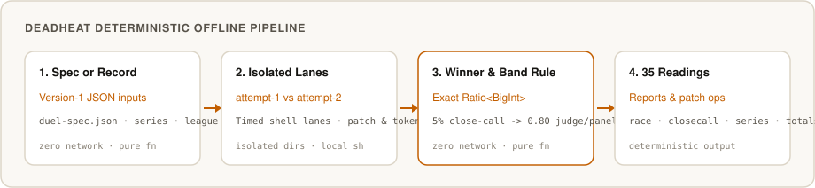

  <picture>
    <source media="(prefers-color-scheme: dark)" srcset="media/deadheat-architecture-dark.svg">
    <source media="(prefers-color-scheme: light)" srcset="media/deadheat-architecture-light.svg">
    
  </picture>

# Deadheat Architecture

Deadheat pairs a local two-lane command runner and patch adopter with an exact race, series, and championship analytics engine. All thirty-five analytical reading commands are pure offline functions over version 1 JSON artifacts.

## Four-Stage Pipeline

1. **Workspace duel runner (`specs`, `runner`).** `deadheat run` validates a version 1 race specification, recreates two isolated lane directories (`attempt-1` and `attempt-2`) under `<workspace>`, executes each lane's shell command (`/bin/sh -c`) with wall-clock timing, reads optional `result.json` status/tokens and `patch.diff` text from each lane, and writes a version 1 race record.
2. **Scratch, handicap, and close-call scoring (`races`, `seats`, `panels`).** Attempts are evaluated by suite result (`green`, `red`, `unfinished`), elapsed seconds plus optional `adjustment` (`DH-11`), and the fixed 5% close-call band (`DH-2`, `DH-5`, `DH-9`, `FIX-DH-9`). Both `green` attempts within `0 < gap <= 5%` of the slower finish and races where both attempts finish `red` consult recorded single-judge `adjudication` or two-judge `panel` entries (`confidence >= 0.8`).
3. **Series stopping walk (`series`, `championship`).** Series records walk races sequentially under a `wins_target` ("first to N wins"), halting competitive tallying at the deciding race (`DH-6`, `DH-13`) so post-decision races never distort win margins or token spend (`DH-17`).
4. **Thirty-five analytical readings and patch operations (`cli` and reading modules).** Pure functions render race reports, standings tables, handicap flips, championship tables, pairings, and twenty-seven decided-series trajectory readings, while `adopt` and `discard` export or remove loser `.patch` files (`DH-3`).

## Module Map

| Module | Responsibility |
| --- | --- |
| `rust/src/cli.rs` | Thirty-eight command dispatcher, `--help` terminal width detection (`COLUMNS` / `TIOCGWINSZ`), and exit routing |
| `rust/src/specs.rs`, `runner.rs` | Race specification validator and two-lane local subprocess duel runner |
| `rust/src/races.rs` | Race record and standings loaders, winner and close-call rules, and `adopt` / `discard` patch helpers |
| `rust/src/seats.rs`, `panels.rs` | Raw LLM route envelope parsers (`Jev` and `chat`) and two-judge panel synthesizer (`DH-7`, `DH-9`) |
| `rust/src/series.rs`, `flips.rs` | First-to-N series scorer and scratch-vs-handicap flip analyzer |
| `rust/src/championship.rs`, `totals.rs`, `pairings.rs` | Multi-series championship aggregator, decided-walk token spend counter, and head-to-head pairing matrix |
| `rust/src/comebacks.rs`, `distances.rs`, `rallies.rs`, `deadlocks.rs`, `streaks.rs`, `clusters.rs`, `closings.rs`, `openings.rs`, `turns.rs`, `leads.rs`, `crossings.rs`, `tenure.rs`, `depths.rs`, `spells.rs`, `reigns.rs`, `place.rs`, `peak.rs`, `recovery.rs`, `laststand.rs`, `firststand.rs`, `firststrike.rs`, `firstreign.rs`, `lastreign.rs`, `leadchanges.rs`, `outset.rs`, `tail.rs`, `crosshead.rs` | Twenty-seven decided-series trajectory and momentum classifiers |
| `rust/src/makers.rs` | Offline pilot artifact rebuilder verifying recorded adjudication envelopes byte for byte |
| `rust/src/json.rs`, `pynum.rs`, `pytext.rs`, `pyunicode.rs`, `scan.rs` | Depth-bounded JSON parser, exact decimal/rational formatting, line-break fencing, and codepoint scan |

## Determinism and Safety Invariants

- **Exact rational timing and margins.** Finish adjustments, the 5% close-call band, and aggregate championship margins run through `pynum` exact arithmetic so decimal boundaries never suffer binary float rounding error.
- **Boundary against `myriad`.** `deadheat` always races **two** attempts at one task with a verification gate to crown a winner. Open-ended multi-branch research without a pass/fail oracle belongs to `myriad`.
- **Single-line label fencing.** Every model name, environment label, adjudicator name, and task title is fenced against embedded newlines at both the JSON loader and library API boundaries (`FIX-DH-16`).
