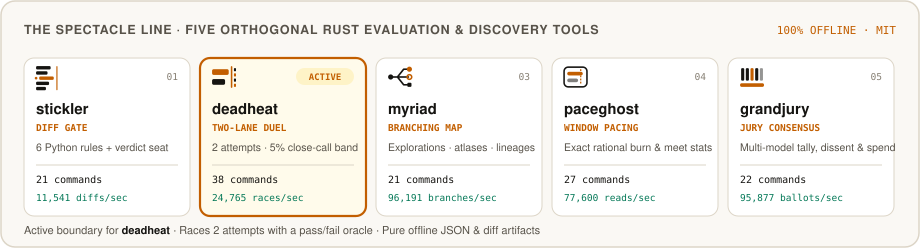

  <picture>
    <source media="(prefers-color-scheme: dark)" srcset="media/spectacle-arc-dark.svg">
    <source media="(prefers-color-scheme: light)" srcset="media/spectacle-arc-light.svg">
    
  </picture>

# Deadheat in the Spectacle Ecosystem

Deadheat is the two-lane competitive duel in the Spectacle Line. Whenever a task has an objective verification suite (`green` vs `red`) and two competing model attempts, `deadheat` runs or reads the duel, applies optional time handicaps and the five-percent close-call band, salvages loser patches, and tracks thirty-five series and championship momentum metrics.

## Spectacle Line Boundary Matrix

Every tool in the Spectacle Line answers one sharp question over plain local files with zero overlapping scope.

| Tool | Core Question Answered | Primary Input | Declares a Winner? | Commands |
| --- | --- | --- | --- | --- |
| **`stickler`** | Does this Python diff violate six built-in code rules, and how did two model routes judge its borderline lines? | Unified `.diff`, change set, split, collection JSON | Verdict (`accepted` / `sent back`) | `21` |
| **`deadheat`** | Which of two competing attempts won this task under a pass/fail check, clock, handicap, and 5% close-call band? | Race spec, race, standings, series, championship JSON | **Yes** (single winner or `no result`) | `38` |
| **`myriad`** | What open sub-questions, settled findings, ruled-out paths, and `dibs` claims exist across this investigation over time? | Exploration, atlas, lineage JSON | **Never** (survey map only) | `21` |
| **`paceghost`** | Will this run finish inside its timed budget window, who holds the pace record, and how is the chaser pack distributed? | Run, field, field-day, ladder, rematch, meet JSON | Record holder only (no scheduling) | `27` |
| **`grandjury`** | Where do multi-model juror panels agree, abstain, dissent, or swing across discrete-choice poll waves, and at what cost? | Poll, prices, sequential `poll-NN.json` wave dirs | Plurality / accord (never grades right/wrong) | `22` |

## Why Local Deterministic CLIs Instead of Cloud Eval Dashboards

| Dimension | `deadheat` (Spectacle Line) | Cloud Eval SaaS | Ad-hoc Python Scripts |
| --- | --- | --- | --- |
| Network & data residency | Zero sockets in `deadheat` itself, analytical paths 100% offline | Uploads diffs, prompts, and traces to third-party servers | Often mixes live SDK calls with scoring |
| Numeric determinism | Exact `BigInt` & `Ratio<BigInt>` `5%` close-call band + handicap arithmetic | IEEE-754 float drift across runtimes | Float rounding and Python/OS version drift |
| Input validation | Whole-file defect lists + single-line `\n`/`\r` fencing | Partial ingestion or opaque 400 errors | Uncaught `KeyError` tracebacks |
| Distribution | Single `1188 KiB` native binary (`Linux`, `macOS`, `Windows`) | Account signup + API keys + Node/Python SDKs | Virtualenv + dependency lock churn |
| Schema contract | Normative `CONTRACT.md` + Draft 2020-12 `schemas/*.schema.json` | Proprietary evolving payloads | Implicit dict keys |
