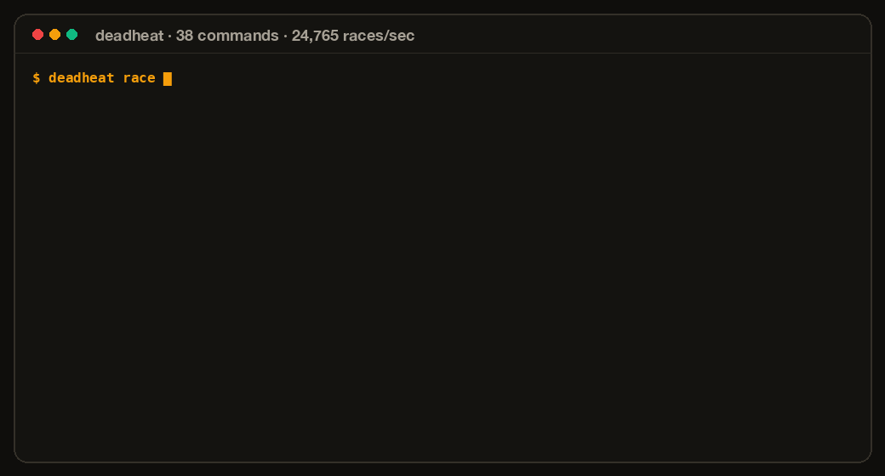
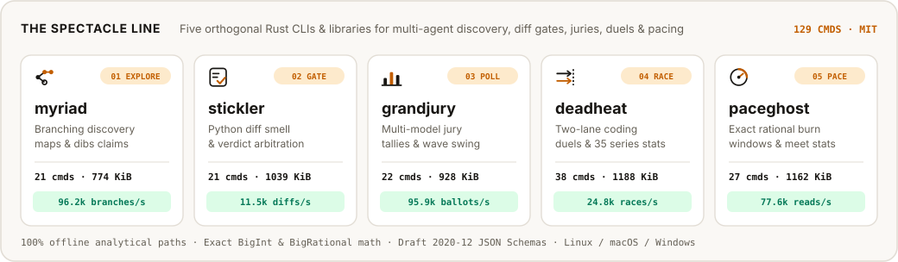

  <picture>
    <source media="(prefers-color-scheme: dark)" srcset="media/deadheat-lockup-dark.svg">
    <source media="(prefers-color-scheme: light)" srcset="media/deadheat-lockup-light.svg">
    
  </picture>

# Deadheat Documentation

Head-to-head coding agent duel runner, close-call adjudicator, and thirty-eight-command series analytics.

  

## Documentation Map

| Document | What it covers |
| --- | --- |
| [GUIDE.md](GUIDE.md) | Installation, 60-second walkthrough, categorized command matrix, and multi-agent pipeline recipes |
| [COOKBOOK.md](COOKBOOK.md) | Five-stage closed-loop Spectacle pipeline (`myriad` -> `grandjury` -> `deadheat` -> `stickler` -> `paceghost`), reusable GitHub Action, and `man` page |
| [ARCHITECTURE.md](ARCHITECTURE.md) | Four-stage processing pipeline, module map, exact arithmetic guarantees, and input fencing |
| [COMPARISON.md](COMPARISON.md) | Spectacle Line 5-tool boundary matrix and comparison against cloud eval SaaS and scripts |
| [PERFORMANCE.md](PERFORMANCE.md) | Measured release binary size, sub-100ms benchmark latencies, and parser memory bounds |
| [FAQ.md](FAQ.md) | Scope boundaries, exit codes (`0`, `1`, `2`, `120`), determinism, and troubleshooting |
| [../FORMATS.md](../FORMATS.md) | Normative version 1 JSON and text input schemas, field rules, and minimal examples |
| [../schemas/](../schemas/) | Draft 2020-12 JSON Schema definitions (`*.schema.json`) for IDE autocomplete and CI validation |
| [../completions/](../completions/) | Ready-to-source `bash`, `zsh`, `fish`, and `PowerShell` tab-completion scripts |
| [../man/deadheat.1](../man/deadheat.1) | Offline `man(1)` manual page covering synopsis, commands, exit codes, and examples |
| [../action.yml](../action.yml) | Root composite GitHub Action for installing and running checks in CI workflows |
| [../CONTRACT.md](../CONTRACT.md) | Normative behavioural specification and numbered round obligations |
| [../CHANGELOG.md](../CHANGELOG.md) | Release history and packaging milestones |

## Design Guarantees

- **Zero network sockets in `deadheat` itself.** `deadheat`'s own code makes zero network calls and phones home nowhere. Its thirty-five analytical reading commands are pure read-only functions and `adopt`, `discard`, and `race --standings` touch only the named local files, while external lane commands started by `deadheat run` execute unrestricted in the local shell environment and may use the network.
- **Exact rational timing and margins.** Finish adjustments, the five-percent close-call band, and aggregate championship margins run through `BigInt` and `BigRational` arithmetic with zero float drift.
- **Whole-input defect reporting.** Malformed specifications and records return structured defect lists naming every reachable schema violation before running or printing a report.
- **Single-line output fencing.** Task titles, model identifiers, environment labels, and adjudicator fields reject unpaired UTF-16 surrogates and line breaks (`\n` and `\r`) at both loader and library boundaries, though untrusted text displayed in a terminal should still pass through a pager or sanitizer.

## The Spectacle Line

  <picture>
    <source media="(prefers-color-scheme: dark)" srcset="media/spectacle-showcase-dark.svg">
    <source media="(prefers-color-scheme: light)" srcset="media/spectacle-showcase-light.svg">
    
  </picture>

